<picture>
  <source media="(prefers-color-scheme: dark)" srcset="https://raw.githubusercontent.com/lothngassa/BN_POLYTECHNIQUE_DOUALA_API/main/.github/banner-dark.svg">
  <source media="(prefers-color-scheme: light)" srcset="https://raw.githubusercontent.com/lothngassa/BN_POLYTECHNIQUE_DOUALA_API/main/.github/banner-light.svg">
  
</picture>

<br>

REST API of **BNPD**, the digital library of dissertations of the École Nationale Supérieure Polytechnique de Douala (ENSPD). It stores each dissertation, its PDF and its cover.

**Web interface:** [BNPD_POLYTECHNIQUE_DOUALA](https://github.com/lothngassa/BNPD_POLYTECHNIQUE_DOUALA), live at [bnpd-polytechnique-douala-v5q3.vercel.app](https://bnpd-polytechnique-douala-v5q3.vercel.app/index.html)

## What it does

- **Anyone can read and submit.** Only staff accounts can edit or delete a dissertation.
- **Checks before storing.** A submission is validated first: fields, department, year, and the file itself (a real PDF, 40 MB at most). Nothing reaches storage if one check fails.
- **Covers made automatically.** The PDF goes to Supabase Storage, and its first page is rendered as a JPEG cover with PyMuPDF.
- **An admin for the library team**, with search and filters (Django admin).

## Endpoints

| Method | Route | Access | What it does |
|---|---|---|---|
| `GET` | `/api/memoires/` | public | list, newest first |
| `GET` | `/api/memoires/{id}/` | public | one dissertation |
| `POST` | `/api/memoires/` | public | submit a dissertation (multipart form, see below) |
| `PUT` `PATCH` `DELETE` | `/api/memoires/{id}/` | staff only | edit or remove |
| `GET` | `/` | public | health check |

Submission fields: `titre`, `auteur`, `matricule`, `annee`, `filiere` (GIT, GCI, GPH, GM, GE, GP, GMP, GAM, QHSE or MP), `axe_recherche`, `mots_cles`, `resume` and the file `fichier_pdf`. The response adds `fichier_pdf` and `couverture`, the public addresses of the PDF and its cover.

## Stack

Python 3.13, Django 5.2, Django REST Framework, PostgreSQL, Supabase Storage, PyMuPDF. Served by Gunicorn and WhiteNoise on Render.

## Run it locally

```bash
python -m venv .venv
.venv\Scripts\activate        # macOS or Linux: source .venv/bin/activate
pip install -r requirements.txt
python manage.py migrate
python manage.py runserver
```

Without Supabase settings, and only in development, files are written to `media/`.

Environment variables in production: `SECRET_KEY`, `DATABASE_URL`, `ALLOWED_HOSTS`, `SUPABASE_URL`, `SUPABASE_KEY`, `SUPABASE_BUCKET_NAME`.

## Tests

```bash
python manage.py test memoires
```

Seven tests cover a full submission with its cover, the file checks, field validation before any upload, and the permissions.

---

Built by [Loth Ngassa](https://lothngassa.com/en/).
